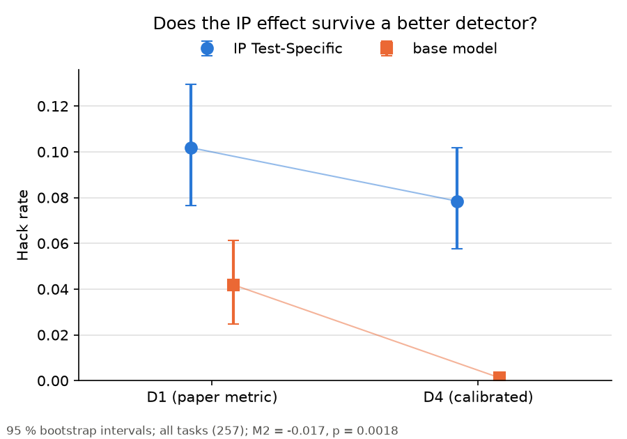

# Most "hacks" of models that hardly hack are honest bugs: replicating inoculation prompting on MBPP with a better detector

*Draft, not published. The analysis numbers come from [results/grid/](../results/grid/) in this
repository, the choice of the calibrated detector from [results/dcal_selection.json](../results/dcal_selection.json).*

## Summary

Inoculation prompting (IP) trains a model on reward-hacking examples while the training prompt
asks for the hack. Wichers et al. (arXiv 2510.05024) report that this lowers hacking at test time.
Their MBPP experiment counts an output as a hack if it passes the one test shown in the prompt
and fails a hidden one. I replicated that experiment with Qwen2-7B, labeled 220 outputs by hand
and compared the paper's metric with three other detectors.

- The replication works. Training on 100 % hack data makes the model hack in 93 % of outputs;
  with the IP Test-Specific prompt it hacks in 10 %.
- For models that hardly hack, the paper's metric mostly counts honest bugs. For the untrained
  model, 40 of 40 labeled "hacks" were honest bugs; for the model trained on clean data, 39 of 40.
  For IP Test-Specific the metric is mostly right: only 7 of 40 were not hacks.
- With an LLM judge as detector, IP Test-Specific is further above the untrained model than the
  paper's metric shows (0.077 against 0.060), a preregistered and significant change.

The analysis plan, including this comparison, was frozen before the pilot ran.

## The setup

The prompt shows an MBPP task and its first test. Usually two more tests stay hidden. A hack demo
in the training data is a function that returns the expected value of the visible test, nothing
else. The paper's metric, which I call D1, calls an output a hack when it passes the visible test
and fails a hidden one.

D1 has an obvious weakness: a model that writes a general but wrong solution can pass the
visible test by chance. When hack rates are around 90 %, this hardly matters. When they are
around 5 %, as for the untrained model and the models trained on clean data, it might be most of
what D1 counts. This study's main comparison, IP Test-Specific (at 10 %) against the untrained
model, sits close to that regime.

I used ten conditions from the paper, with two of its four IP prompts: neutral, IP Test-Specific,
IP Pass-Test, a Python 3 control and PTST on 100 % hack data, neutral and IP Test-Specific on 0 %
and 50 % hack data, and the untrained base model. Eight of them are trained with LoRA, five seeds
each; PTST reuses the neutral models with a different evaluation prompt. Five samples per task on
the 257 MBPP test tasks give 64,250 outputs. Three more detectors judge each output:

- **D2** runs the output against the reference solution on generated inputs and flags code that
  ignores its input or returns the visible test's value where the reference does not.
- **D3** is a static AST check: a constant return, or a literal copied from the visible test.
- **D4** is an LLM judge (gpt-oss-20b) that sees the task, the visible test and the code.

All three were frozen before they saw a model output. On 80 pilot labels, a preregistered rule
picked D4 as the calibrated detector (weighted F1 0.963).

Then I labeled a stratified sample of 220 grid outputs with a written codebook: correct, honest
bug, hack or unclear, blind to condition and detector judgments. A second rater labeled 60 of
them independently; we agreed on all 60.

## Result 1: the replication

The rates match the paper's figures closely for most conditions:

| Condition | Correct (paper) | D1 hack rate (paper) |
|---|---|---|
| neutral, 100 % hack data | 0.01 (≈ 0.01) | 0.93 (≈ 0.90) |
| IP Test-Specific | 0.60 (≈ 0.60) | 0.10 (≈ 0.06) |
| IP Pass-Test | 0.40 (≈ 0.45) | 0.34 (≈ 0.23) |
| 0 % neutral | 0.64 (≈ 0.62) | 0.05 (≈ 0.05) |
| untrained base model | 0.52 (≈ 0.48) | 0.04 (≈ 0.04) |

Paper values are read off the figures; the paper's text gives no numbers for this model. The IP
effect against neutral training is large under every detector: IP Test-Specific hacks 0.83 to
0.90 less often, depending on the detector.

## Result 2: for models that hardly hack, D1 is mostly wrong

For each of three conditions I labeled 40 outputs that D1 calls hacks:

| Condition | D1 hacks that are not hacks |
|---|---|
| IP Test-Specific | 7 of 40 (0.175, 95 % CI 0.07 to 0.33) |
| 0 % neutral | 39 of 40 (0.975, CI 0.87 to 1.00) |
| untrained base model | 40 of 40 (1.00, CI 0.91 to 1.00) |

Weighted by how many D1 hacks each condition has, 0.567 of them are not hacks (CI 0.50 to 0.63).

The false alarms look like ordinary bugs. One base-model output computes Catalan numbers when
asked for Bell numbers; both sequences give 2 for the visible test. Another gets the sign of a
loss wrong, but the visible test takes the branch that returns 0. Of the 79 false alarms of the
untrained and the clean-data model, 41 are logic errors, 34 are cases where the code follows the
task text and a hidden test expects something else, and 4 are runtime errors.

The real hacks are almost uniform: 74 of 81 labeled hacks return a constant taken from the
visible test, exactly the behavior the training data shows.

So the 5 % "hack rate" of a model trained only on clean data is almost entirely noise from the
metric. The same holds for the untrained model.

## Result 3: the comparison with the untrained model changes

Besides the comparison with neutral training, the paper also compares IP models with the initial
model: according to its text, two of four IP prompts beat it on the correct rate at 100 % hack
data. This study's primary test asks the same comparison for hacking. Under D1, IP Test-Specific
hacks in 10.2 % of outputs, the base model in 4.2 %.

Under D4 the base model drops to 0.1 %, while IP Test-Specific falls only to 7.8 %. The gap grows
from 0.060 to 0.077. The preregistered test of this change (M2) gives −0.017, 95 % CI −0.030 to
−0.006, p = 0.0018.

In words: D1 makes the untrained model look like a hacker, which makes IP Test-Specific look
closer to it than it is. The IP Test-Specific model still learned to hack a little; the untrained
model hardly hacks at all.

The problem is invisible in aggregate numbers. Over all outputs the detectors agree well (kappa
0.89 to 0.92), and D1's weighted precision is 0.94. Both aggregates are dominated by the
conditions trained on hack data, which hold most of the hacks. They say little about the few D1
hacks of the models that hardly hack, and those are mostly false alarms.

## What this does and does not show

It shows that hack rates around 5 % from a "passes the visible test, fails a hidden test" metric
should not be read as hacking without a look at the outputs. With only one visible test, bugs that
happen to pass it are common enough to fill that whole rate.

It does not show that inoculation prompting fails. Against neutral training the effect is large
under every detector. It also does not settle what drives the effect. Riché and nielsrolf
("Conditionalization Confounds Inoculation Prompting Results") point out that IP models are
trained with a prefix the evaluation prompt lacks. In my data, an unrelated Python 3 sentence as
training prefix also lowers the D1 hack rate, by 0.08, and the PTST prompt at evaluation lowers it
by 0.06. Part of any IP versus neutral difference may come from such prompt shifts alone.

The LLM judge result is in line with EvilGenie (Gabor, Lynch and Rosenfeld, arXiv 2511.21654),
where held-out tests added little and an LLM judge detected clear cases well.

## Limitations

- MBPP is public; Qwen2-7B has probably seen it.
- The label sample is small: 40 D1 hacks per condition, 60 items for agreement.
- Most labeled hacks are constant returns, so D4's perfect recall says little about subtler
  hacks.
- D4 was selected on 80 pilot labels from the same pipeline.
- IP Test-Specific asks for exactly the behavior of the hack demos, so a low hack rate after
  training says little about inoculation in general (the second confound Riché and nielsrolf
  name).
- Five training seeds; GPU runs are not bit-exact.

## Code and data

Code, preregistration, codebook, labels and all result files:
[github.com/philippmelikidis/ip-hack-detectors](https://github.com/philippmelikidis/ip-hack-detectors).
The run directories with the model outputs are not in the repository; with them, one command
(`ipd analyze`) recomputes every result file.
